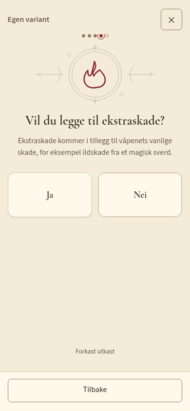
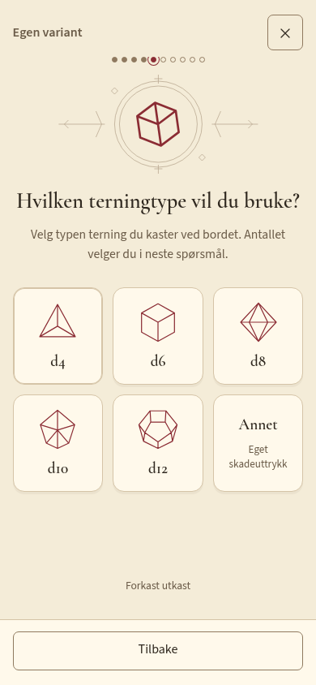
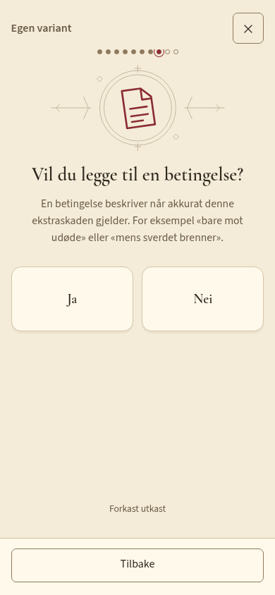

# Prøveversjon: enklere føring ved bordet

> Tallbetjeningen nedenfor og eldre bilder er historiske. #25 erstatter innfelte hjul/absolutte GP-verdier med felles fullskjermdialog: trykk verdien, velg en endring fra 0, kontroller Før/Etter og bekreft med OK eller forkast med Avbryt/X. Midttrykk bytter hjulområdet til et eget tallpanel som viser en visuell 0 ved tom innskriving uten inputfelt, tekstmarkering eller systemtastatur over verdien. Penger har signerte GP-/CP-hjul. Båndet er fast; dialogen er låst mot bakgrunnen. HP-pillen korrigerer bare vanlig HP mellom 0 og maks og bevarer temp HP. Ta skade tillater bare reduksjon og bruker temp HP først. Se [produktkontrollen](CHARACTER_WORKSPACE.md#før-koding-kontroll-felles-tallendringsdialog-25) og [testinstruksjonene](TESTING.md#test-av-tallendringsdialogen-25).

Dette er den samlede implementasjonen bestilt etter gjennomgangen i [WORKFLOW_REVIEW](WORKFLOW_REVIEW.md), med [krav §13](REQUIREMENTS.md#13-konseptuell-opprydding-og-arbeidsflyter-2026-10-20) og nyere avklaringer som føring. v0.11 er brukt som funksjonell referanse; papirarket og spillerens manuelle føring er målet. Historiske slider-/trefane-/per-terning-forslag er erstattet av valgene under.

## Betjening

| Mål | Arbeidsflyt |
| --- | --- |
| Opprette karakter | Meny → Ny karakter: navn → art → klasser → subklasser → klassenivåer → abilities → maks HP, også ved Rediger karakter. Grupperingen er et avgrenset unntak etter [#61](https://github.com/geirskoglund/dnd-character-sheet/issues/61). Tilbake bevarer svar. Artens regeltekst vises ikke i opprettelsen; utstyr og spilltilstand føres inne i appen. |
| Vanlig nytt utstyr | Utstyr → + i riktig gruppe → søk/velg. Direkte tillegg, katalogverdier følger med. Føres som eid; I bruk velges fra gjenstandens kort. Ingen mellomdialog. |
| Egen våpenvariant | Tilpass ved katalogvåpen → navn/valgfri merknad → valgfri endring av grunnskade/ekstraskade. Hver ekstraskade har uttrykk, skadetype fra liste og eget ja/nei-spørsmål om betingelse. Betingelsen vises på kortet og i Combat. |
| Egne egenskaper/spells | Kort veiviser for navn/type/nivå og valgfri tekst. Flere detaljer gir tilgang til eksisterende handlinger, koblinger, ikoner og manuelle overstyringer. Ingen obligatorisk fullskjema for normal føring. |
| Finne egenskap/feat/spell | Mine klasser som standard, relevante nivåer/subclass/tilgang; generelle gyldige feats beholdes. Typeknapper for Egenskaper/Feats. Alle klasser og overstyring finnes. Direkte valg registrerer og lukker. Kilde spørres bare hvis flere passer. |
| Administrere magi | Egen Magi-fane: cantrips, spells, bok/forberedt og casting-verdier. Fire ikoner og Meny nederst med tilgjengelige navn. Combat viser relevante oppslag fra samme data. |
| Forberede spells | Forbered spells → eventuelt klassevalg → søk/avkrysning → Ferdig. Wizard bruker egen bok, Cleric/Druid/Paladin sine regler. Valgt/maks og gratis alltid-forberedte vises. Over vanlig grense gir et DM-varsel, men kan lagres. |
| Bruke slot/annen beholdning | Trykk pille → Bruk én eller Gi tilbake én. Lagrer og lukker direkte; Meny → Angre. Tilpass gir direkte telling og manuell maks. |
| Føre Hit Dice | Hvile viser tilgjengelig/maks per klasse/terning. Enkel telling, ingen påkrevd registrering av rå terningkast. Rull/regn ved bordet; HP føres separat, eventuelt som ett samlet delta. |
| Ny egen beholdning | Navn → maks/tilgjengelig → kort/lang/manuell gjenoppretting. Tilgjengelig starter lik maks. Spell slots og Hit Dice har konkrete plasseringer, ikke generisk typevalg her. |
| Lang hvile | Hvile → Lang hvile → kort preview av faktiske endringer → Fullfør hvilen. Betingede gjenopprettinger velges eksplisitt. Hele endringen kan angres samlet. |
| Justere tall | Direkte tallfelt eller ↕: vertikalt, begrenset tallhjul. Valgt verdi i midten; trykk på den for tastatur. HP bruker signert delta og før/etter-visning; valget står til bekreftelse. Null HP kan økes igjen. |

AC-forklaringen ligger i Utstyr. Rutinemessige «lagret»-meldinger er fjernet; lagringsfeil vises tydelig og utkast beholdes for nytt forsøk. Hjørnetrekant brukes på arbeidsflatens oppslag, ikke navigasjon, Combat-tabs, X eller selvforklarende listevalg. Utstyrsgruppene fra prototypen beholdes. Våpenkort får mer bredde for uttrykk/betingelser; pillene er uniforme innen hver gruppe, artsegenskaper beholder tett grid.

## Regelstøtte og bevaring

Kildene er SRD 5.1 / D&D 5e 2014 og de samme pinnede 5e-database-dataene som eksisterende katalog. `scripts/import-context.mjs` gjenskaper lokale nivåtabeller og strukturerte forutsetninger fra revisjon `a6212beb4b278917c2cff41c2b04c4ef4f3e0d6f`. Lisens/attribusjon følger appen; normal bruk og bygg trenger ingen regel-API.

- Wizard3 gir 4 nivå1 og 2 nivå2-slots. Wizard1/Cleric4 gir felles 4/3/2, men Wizard kan fremdeles bare velge sine nivå1-spells. En valgt Wizard-skole utelukker ikke klasselistens øvrige skoler.
- Én half-caster bruker sin egen tabell; flere Spellcasting-klasser bruker multiclass-tabellen med hver halvklasse rundet ned. Warlock Pact Magic er separat og bytter slotnivå på samme beholdning.
- Nivåendring bevarer antall brukt. Manuell maks og eldre manuelle pools bevares uten duplisering. Spillertilpassede navn og hvilevilkår beholdes; ordinære genererte navn/vilkår følger klassen. Bardic Inspiration går eksempelvis fra lang til kort hvile på nivå5 uten å fylle brukt kapasitet. Åpning av app/faner gir ingen karakterlagring/historikk; neste faktiske bekreftede endring lagrer oppsettet atomisk.
- Registrerte Ki, Rage, Second Wind, Action Surge, Bardic Inspiration, Sorcery Points, Lay on Hands, Wild Shape og Arcane Recovery har utvalgt, sikker beholdningsstøtte. Ki krever eksplisitt meditasjonsbekreftelse ved hvile. Arcane Recovery er særregel/manuelt. Ubegrenset Rage/Wild Shape på nivå20 får ingen oppdiktet endelig teller.
- Lang hvile fyller vanlig HP/ordinære slots og relevante beholdninger, fjerner ordinær temp HP og gir tilbake inntil halvparten av totalt maksimalt antall Hit Dice, rundet ned, minst én. Ved normal klasseføring tilsvarer dette halvt totalnivå. Monk4 1/4 blir 3/4. Ved tvetydig multiclass-fordeling velges terningtypene manuelt. Manuelle/særregel-beholdninger, conditions og exhaustion behandles manuelt; DM avgjør om hvilen gjelder.
- Ukjente forutsetninger merkes og beholdes fremfor å forsvinne. Eksplisitt ekstra tilgang kan registreres på en egenskap under Flere detaljer, med klasseliste/nivå og ability. Dette gir tilgang i velgeren, ingen oppdiktede slots. Tieflings støttede medfødte spellvalg følger totalnivå og CHA, separat fra klassevalg.
- Schema/backup2 og IndexedDB3 beholdes, med valgfrie additive felter. UUID-er og kilder remappes ved kopi; komponentbetingelser og hele aggregatet følger save/backup/import/undo. Samtidighetskonflikter og mislykket lagring gir ikke bekreftet endring.

## Faktisk produktgjennomgang

Kontrollert i produksjonsbygget under `/dnd-character-sheet/`, med ekte UI-registrering og lokale data:

- Mira, Elf Wizard3/Evocation INT16: Fire Bolt/Mage Hand, Invisibility og Shield fra riktig liste; skolevalg hindrer ikke Invisibility. Forberedt fra egen bok, attack+5/DC13, slots4/2 og samme oppslag i Combat. Katalogvariant Flammetunge beholdt grunnprofil, +1d6 Fire og «Når sverdet brenner» fra veiviseren.
- Nim, Gnome Monk4: ingen Spellcasting-slots, 4d8. Brukt tre Hit Dice gjennom teller, HP ført separat. Lang hvile viste HP20→28 og d8 1→3/4. Ki lagt til gjennom relevant klasseliste, med automatisk beholdning.
- Wizard1/Cleric4, Cleric3/Life, generelt Grappler og egen magitilgang er gått gjennom i nettlesertestene. Gratis domain-spells, forberedelsesgrense/DM-unntak, tvetydig kildevalg og faktisk klassenivå kontrolleres.
- Alle fire faner ved 320/390 px og 100/200 % tekst: 16 kombinasjoner uten horisontal overflyt eller nettleserfeil. Tastatur, faktisk touch på tallhjul ved null HP, faktisk Combat-sveip og offline er kontrollert i egne nettleserscenarioer. Ingen fysisk iOS-/Safari- eller full WCAG-revisjon påstås.

Gjennomgangen fant og rettet utdatert Neste/Legg til ved veivisergren, hjul som ikke fulgte eksakt innskriving, foreldet Pact-pool ved nivåendring og gammelt generert klassenavn på Hit Dice. Våpenpillene var for smale for betingelsesteksten; de har nå større, fortsatt uniform bredde. Korte hvileoppsummeringer bruker kompakt dialog.

Faktiske mobilbilder, ikke designmockups:

| Magi | Tallhjul | Ekstraskade |
| --- | --- | --- |
|  |  |  |

[Utstyr](images/guided-equipment.png) · [Combat](images/guided-combat.png) · [Character](images/guided-character.png) · [Lang hvile](images/guided-rest.png).

## Kontroll og gjenværende omfang

Full lokal kontroll: `CI=1 CHROMIUM_PATH=/usr/bin/chromium npm run check`. Aktuell telling og endelig resultat føres i [kravmatrisen](CHARACTER_WORKSPACE.md). Eksisterende regresjonstester er tilpasset nye godkjente arbeidsflyter; de er ikke hoppet over. Ny `workflows.test.ts` og `e2e/workflows.spec.ts` dekker spillsituasjonene over, i tillegg til tidligere lagring/backup/oppdatering.

Oppdateringsflyten er også rettet etter brukerens rapport: sjekk hvert minutt mens appen er synlig/på nett, i tillegg til fokus/retur og manuelt søk. Ett avvist varsel skal ikke mase frem samme versjon hvert minutt; Meny → Se etter oppdatering henter det frem igjen. Aktivering er fortsatt eksplisitt, og åpne utkast/andre appfaner beskyttes. To-utgavers service-worker-test kontrollerer automatisk oppdagelse, lukking/gjenåpning av varsel, eksplisitt oppdatering og fortsatt offline-data.

Utsatt etter avtale: ny forenkling av proficiencies/skadeegenskaper/tilstandsimmuniteter og samlet ny kort-hvileflyt. Komplett ikke-SRD-/boksubclass-automatikk, tredjedels-castertabeller, alle arts-/featvalg og deres bruksgrenser, alle standardhandlinger og sammensatt skadekalkulator er fortsatt ikke ferdig. Slike data kan føres manuelt; ingen regeltekst eller fritekstbetingelse tolkes automatisk. Valg av spells/feats, fysisk kast, healing-resultat og DM-unntak eies fortsatt av spilleren. Flere detaljer beholder eksisterende avanserte felt; den vanlige registreringsflyten bruker veiviser.

## Illustrert spørsmålsveiviser og utkast

Nyeste krav §14 erstatter det eldre grupperte skjemaet: **én avgjørelse eller én verdi per skjerm**. Ja/Nei og liste-/terningvalg er store svarflater som går videre ved trykk. Tekst og tall bruker Neste. Tilbake bevarer svar, også når en forgrening skjules og åpnes igjen. Forklaringen gjelder spørsmålet på skjermen; ingen generell avkrysning for «endre spillverdier».

Våpenvarianten spør navn → frivillig merknad → endre grunnskade? → ekstraskade? Ved Ja: illustrert d4/d6/d8/d10/d12 eller Annet → antall (eller eget uttrykk) → skadetype → betingelse? → eventuell tekst → enda en ekstraskade? → kort resultat og Fullfør. Hver betingelse følger sin skade på Utstyr/Combat. Spilleren kaster fysiske terninger og vurderer vilkårene med DM. En nei-gren beholder sikre grunnverdier uten flere skadefelt.

Den felles rammen har lokale SVG-illustrasjoner, journalpalett, grafiske fremdriftspunkter, forklaringer og fast X/Tilbake/Neste eller Fullfør. Ingen synlig «steg X av Y»; skjermleser får posisjonen. Punktrekken følger den aktuelle forgreningen, ikke et løfte om et fast antall spørsmål. Karaktergrunnlag, egne egenskaper/spells og beholdninger bruker samme ramme og én verdi per skjerm. Eksisterende avansert detaljredigering er fortsatt en frivillig ekspertflate.

**Lukk bevarer arbeidet:** X/Escape lagrer svar og posisjon som eget lokalt utkast. Utstyr viser utstyrsutkast, Meny viser alle utkast og uferdige karakterer. Fortsett åpner samme spørsmål etter reload, også uten nett. Fullfør bekrefter posten og fjerner utkastet i samme transaksjon. Forkast utkast krever bekreftelse og endrer ikke ferdige data. Et uferdig våpen finnes ikke i inventar/Combat; uferdig redigering lar den gamle versjonen være. Lagre- eller fanekonflikt lar skjermen/svarene bli stående med tydelig feil. Backup tar med utkast; kopi kopierer bare ferdige karakterdata.

Penger bruker **to uavhengige hjul: hele GP og 00–99**, med samme midtmarkering og tydelig ramme. Trykk beløpet for direkte innskriving. CP er fortsatt lagret eksakt som heltall; negative verdier, for mange desimaler og tall utenfor støttet område forklares og kan ikke bekreftes. HP/temp HP i Combat har rammefarget hjørnemarkør; passive verdier og selvforklarende knapper har ingen.

Faktisk produktgjennomgang: Eirik Human Fighter3/Champion STR16, katalog-Longsword → Flammetunge +2d6 Fire «Når sverdet brenner», utkast/fortsett og resultat. Ja/nei-, terning-, betingelses- og pengeflater er kontrollert ved 320/390/768 px og 100/200 % tekst (24 kombinasjoner), med faste lukk-/bekreftelsesområder, én verdi eller ingen tekstfelt per spørsmålsflate og ingen horisontal overflyt eller pageerrors. Skjermbildene under er fra produksjonsbygget. Egen gjennomgang fant at blur på tallfelt tegnet om siden og kunne sluke neste trykk; dette er rettet. Uendret klassevalg beholder nå subclass og svar ved Tilbake.

| Direkte svar | Terningtype | Forklaring av betingelse |
| --- | --- | --- |
|  |  |  |

[Utstyrsutkast](images/illustrated-draft.png) · [Resultat](images/illustrated-summary.png) · [To pengehjul](images/illustrated-money.png).

`wizard-drafts.test.ts` dekker isolasjon, revisjon, rollback/retry, backup og eksakt penger. `e2e/illustrated.spec.ts` bruker faktiske svarflater, flere skadekomponenter, forklaring, samme posisjon etter offline reload, uferdig redigering/Combat, forkast/avbryt, lagringsfeil, to faner, endret original, backup/import, uferdig karakter og pengehjul/touch. Tidligere regresjoner er tilpasset faktisk spørsmålsnavigasjon uten å skrive skjulte felter. Fullkontrollens resultat føres i kravmatrisen.

Begrensning: lokal lagring følger nettleserens vanlige varighet; systemets tvangslukking mens en IndexedDB-skriving fortsatt pågår kan ikke garanteres. Åpne ekspertflater har fremdeles sine gamle eksplisitte Lagre/Avbryt-handlinger; deres senere felt blir ikke autolagret som veivisersvar. Ingen fysisk iOS/Safari- eller full tilgjengelighetsrevisjon påstås. Tidligere avtalte utsatte flyter og regelområder over består.

## Nyere utstyrsflyt fra godkjent prototype

Den generiske utstyrspopupen og den første våpenveiviseren er erstattet for ny føring. Se [Utstyr: føring og oppslag](EQUIPMENT.md) og [faktisk mobilreview](reviews/equipment-app/README.md). Ett samlet virkningsområde, egne bonus-/beskyttelses-/effektspørsmål, lagring direkte fra aktuell flate, håndvalg/kopi og kildeknyttede brukstellere er nå produksjonsflyten. Historiske skjermbilder og begrensninger over beskriver forrige utgave; eldre utkast kan fortsatt fullføres med kompatibilitetsveiviseren.
