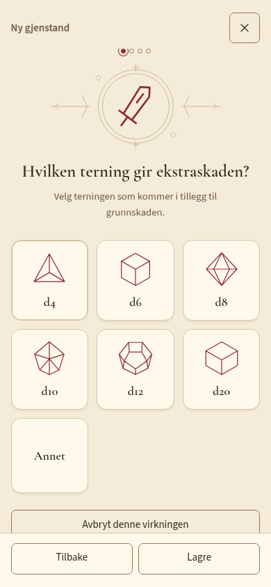
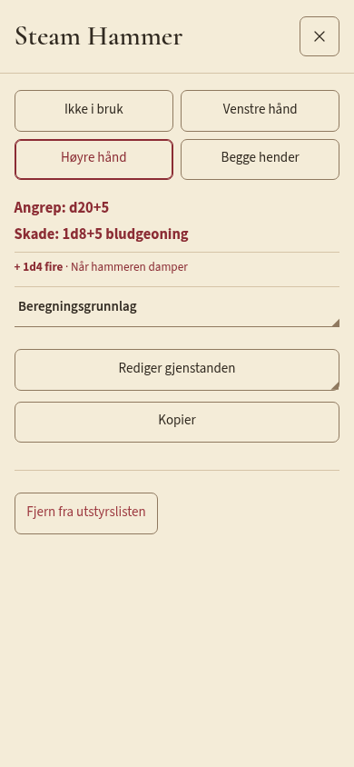
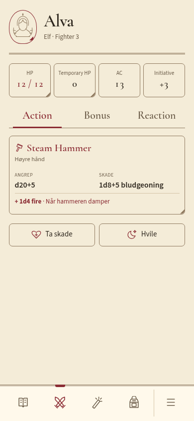
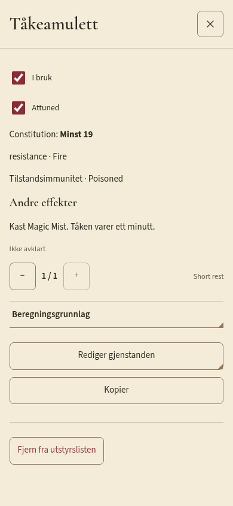
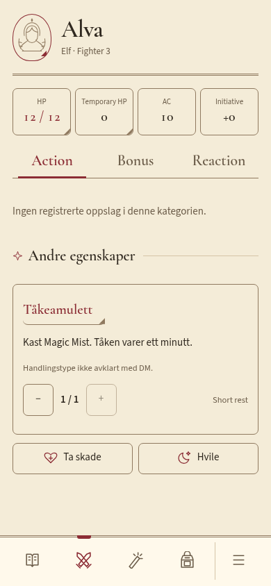

# Produktgjennomgang av utstyr i hovedappen

Faktiske UI-flyter i produksjonsbygget, Chromium med mobilstørrelse. Ingen prototypeverdier er koblet inn i appen. Dette er i tillegg til automatiserte tester, og er ikke en fysisk iPhone/Safari-test eller full tilgjengelighetsrevisjon.

Fighter3/Elf, STR16/DEX16: Warhammer → Steam Hammer → skadebonus2 → ekstraskade1d4 Fire under «Når hammeren damper» → Lagre direkte fra betingelsen → Høyre hånd → lukket popup. Oppslaget og Combat viser d20+5 og1d8+5 bludgeoning, med ekstraskaden på egen betinget linje. Håndbruk står øverst; Beregningsgrunnlag og Rediger har rammefarget hjørnemarkør. Enkeltvåpenets Combat-kort kan bruke tilgjengelig bredde, mens + i Utstyr følger radens cellestørrelse.

| Ett spørsmål | Våpenoppslag | Combat |
| --- | --- | --- |
|  |  |  |

Fighter3 med CON14 og egen Tåkeamulett: minstCON19, Fire resistance, Poisoned immunity, Magic Mist1/short rest, Ikke avklart handlingstype og krav om attunement. Før attunement vises14, etter19. Grunn-CON endret til20 gjennom vanlig karakterredigering forblir20. Virkningen vises under Andre egenskaper med tydelig uavklart handlingstype; bruk fra Combat viser samme0/1 i oppslag, og faktisk kort hvile gjenoppretter1/1.

| Oppslag med kilder | Uavklart effekt i Combat |
| --- | --- |
|  |  |

Plasskontroll: terningvalget ved320/390/768px ×100/200%tekst og amulettoppslag ved320/390px ×100/200%. Ingen horisontal dokument-/dialogoverflyt eller pageerrors observert. Fast lukkeknapp er tilgjengelig, spørsmålsinnholdet kan scrolles, og footer blir stående. Stor tekst trenger vertikal scrolling; all informasjon er ikke samtidig synlig. Første gjennomgang fant «Tilbake» delt over to linjer og unødig stor illustrasjon ved320px/200%; knappeluft og illustrasjon ble justert og kontrollert på nytt. [Stor tekst etter retting](dice-320-large.png), [layoutmålinger](layout-review.json), [effektkontroll](effect-review.json).

Forskjeller fra prototypen er tilsiktede: hovedappen bruker faktisk klasse/proficiency, egne eksisterende ressurser og tallhjul, ikke faste prøveverdier. Handlingstype er ett valgfritt regel-/DM-valg etter siste avklaring. Vanlige katalogvalg registreres direkte; egne verdier får veiviser. Kompatibilitetsflyten brukes bare for allerede lagrede eldre utkast. Den opprinnelige store generiske utstyrspopupen brukes ikke for nyregistrering.
