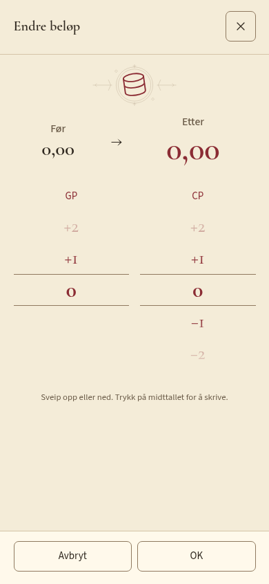
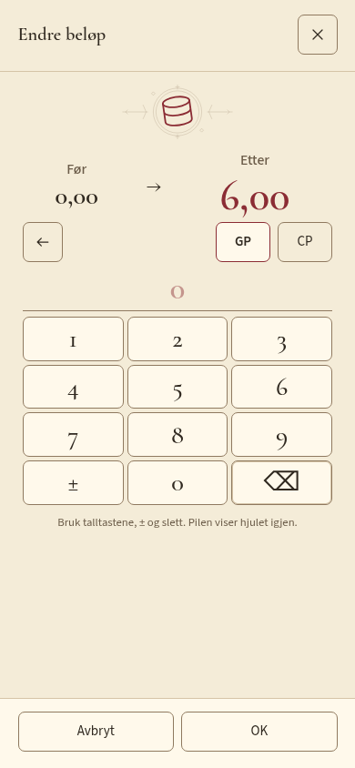
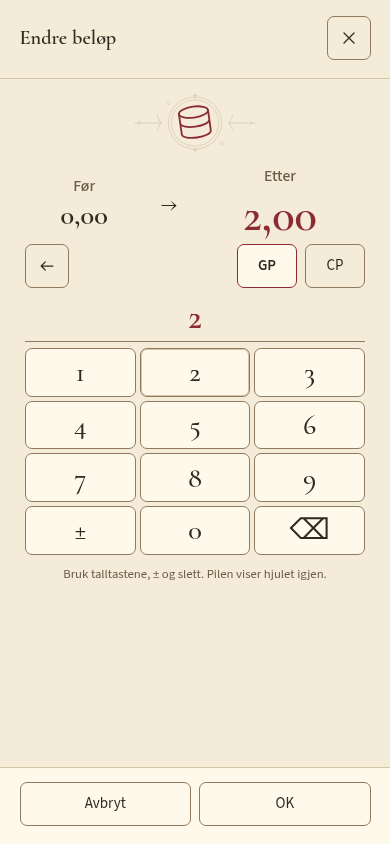
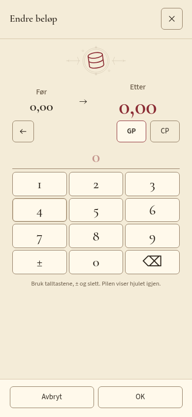
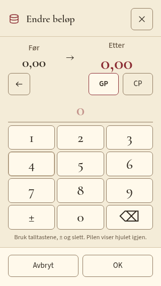
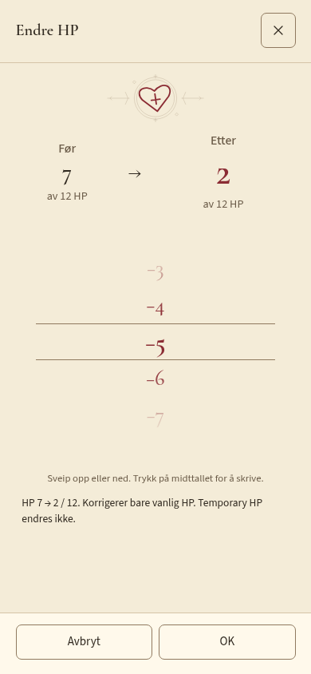
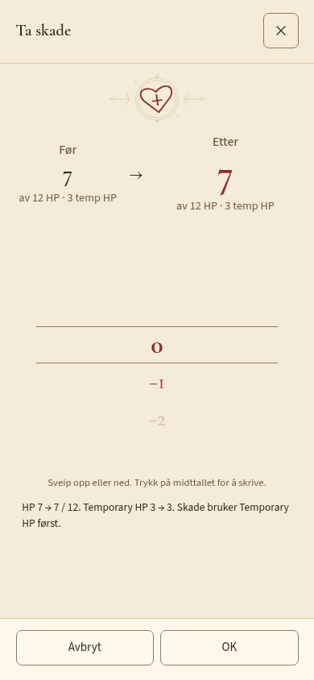
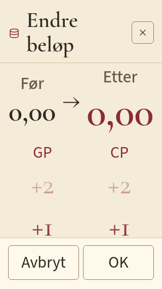
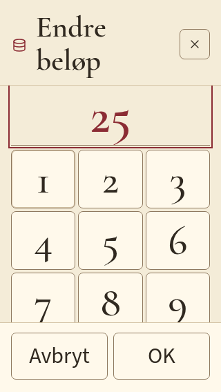

# Produktbilder: tallendringsdialog #25

Faktiske Chromium-bilder fra `tests/e2e/number-review.spec.ts` og `number-corrections.spec.ts` mot produksjonsbygget etter godkjent brukerreview. Før/Etter er større, Etter prioriteres, og båndet står fast utenfor tallrekken. GP/CP deler ett tallpanel; tallvisningen er en ikke-selekterbar tekstflate og viser en diskret null-plassholder når innskrivingen er tom. Plassholderen forsvinner ved inntasting og kommer tilbake ved tømming uten å endre hjulvalget. Ingen native input, teksthåndtak eller systemtastatur brukes. Vanlig tastatur, ekte clipboard-paste og talltastene er funksjonelt prøvd.

200 % tekst på 320 × 568 krever intern innholdsrulling. Store tall tilpasses bredden, og tallvisningens høyde følger skriften. Footer og dialogramme står fast; skjermbildene viser ulike scrollposisjoner, ikke et flyttet popup-vindu.

Brukeren bekreftet første trykk og temp HP på fysisk installert iOS-webapp i forrige utgave `dfe853e`. Disse nye bildene dokumenterer Chromium-layout. Ny fysisk etterkontroll gjenstår. Se [kravmatrisen](../../CHARACTER_WORKSPACE.md#før-koding-kontroll-oppfølging-av-25-etter-fysisk-brukerreview) og [telefonprøvene](../../TESTING.md#test-av-tallendringsdialogen-25).
